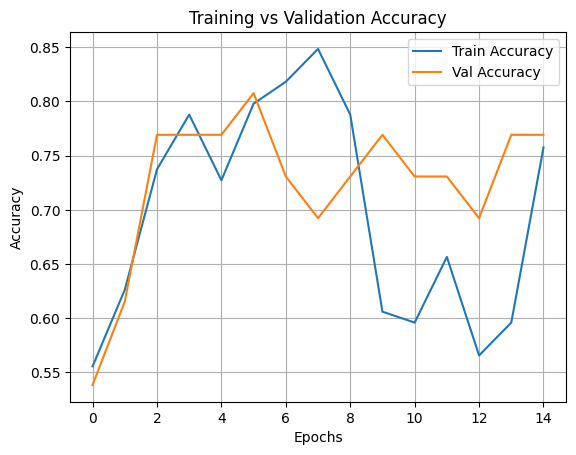

```python
import os
import shutil
import random

# Set paths
original_path = '/home/manideep/Downloads/DATA SET'
split_base = '/home/manideep/Downloads/original_images'  # New split dataset

# Create new directories
for split in ['train', 'val']:
    for class_name in ['Smoker', 'Non-Smoker']:
        os.makedirs(os.path.join(split_base, split, class_name), exist_ok=True)

# Ratio
split_ratio = 0.8

for class_folder, new_label in [('Smokers', 'Smoker'), ('Non-Smoker', 'Non-Smoker')]:
    class_path = os.path.join(original_path, class_folder)
    files = os.listdir(class_path)
    random.shuffle(files)
    
    split_index = int(len(files) * split_ratio)
    train_files = files[:split_index]
    val_files = files[split_index:]

    for f in train_files:
        src = os.path.join(class_path, f)
        dst = os.path.join(split_base, 'train', new_label, f)
        shutil.copy(src, dst)

    for f in val_files:
        src = os.path.join(class_path, f)
        dst = os.path.join(split_base, 'val', new_label, f)
        shutil.copy(src, dst)

print("✅ Dataset split into train/val and saved to /home/manideep/Downloads/original_images")

```

    ✅ Dataset split into train/val and saved to /home/manideep/Downloads/original_images


```python
import cv2
import os

# Paths
original_dataset = '/home/manideep/Downloads/original_images'
roi_dataset = '/home/manideep/Downloads/roi_dataset'

face_cascade = cv2.CascadeClassifier(cv2.data.haarcascades + 'haarcascade_frontalface_default.xml')

for split in ['train', 'val']:
    for label in ['Smoker', 'Non-Smoker']:
        in_dir = os.path.join(original_dataset, split, label)
        out_dir = os.path.join(roi_dataset, split, label)
        os.makedirs(out_dir, exist_ok=True)

        for file in os.listdir(in_dir):
            path = os.path.join(in_dir, file)
            img = cv2.imread(path)

            if img is None:
                continue

            gray = cv2.cvtColor(img, cv2.COLOR_BGR2GRAY)
            faces = face_cascade.detectMultiScale(gray, 1.3, 5)

            if len(faces) > 0:
                x, y, w, h = faces[0]
                face = img[y:y+h, x:x+w]
            else:
                face = img  # fallback: full image

            resized = cv2.resize(face, (224, 224))
            cv2.imwrite(os.path.join(out_dir, file), resized)

print("✅ ROI Cropping Complete — Saved to /home/manideep/Downloads/roi_dataset")

```

    ✅ ROI Cropping Complete — Saved to /home/manideep/Downloads/roi_dataset


```python
import numpy as np
import matplotlib.pyplot as plt
import seaborn as sns
from sklearn.utils.class_weight import compute_class_weight
from sklearn.metrics import confusion_matrix, classification_report
from tensorflow.keras.preprocessing.image import ImageDataGenerator
from tensorflow.keras.applications import InceptionResNetV2
from tensorflow.keras.layers import GlobalAveragePooling2D, Dense, Dropout, BatchNormalization
from tensorflow.keras.models import Model
from tensorflow.keras.optimizers import SGD
from tensorflow.keras.callbacks import EarlyStopping, ReduceLROnPlateau

# Paths
train_path = '/home/manideep/Downloads/roi_dataset/train'
val_path   = '/home/manideep/Downloads/roi_dataset/val'

# Data generators
train_gen = ImageDataGenerator(
    rescale=1./255,
    rotation_range=40,
    width_shift_range=0.2,
    height_shift_range=0.2,
    zoom_range=0.3,
    brightness_range=[0.7, 1.3],
    horizontal_flip=True
).flow_from_directory(train_path, target_size=(224, 224), batch_size=16, class_mode='binary')

val_gen = ImageDataGenerator(rescale=1./255).flow_from_directory(
    val_path, target_size=(224, 224), batch_size=16, class_mode='binary', shuffle=False
)

# Class weights
class_weights = compute_class_weight(
    class_weight='balanced',
    classes=np.unique(train_gen.classes),
    y=train_gen.classes
)
class_weights = dict(enumerate(class_weights))

# Load base model
base_model = InceptionResNetV2(include_top=False, weights='imagenet', input_shape=(224, 224, 3))
base_model.trainable = False

# Custom classifier
x = base_model.output
x = GlobalAveragePooling2D()(x)
x = Dense(512, activation='relu')(x)
x = BatchNormalization()(x)
x = Dropout(0.4)(x)
x = Dense(128, activation='relu')(x)
x = Dropout(0.3)(x)
output = Dense(1, activation='sigmoid')(x)
model = Model(inputs=base_model.input, outputs=output)

# Compile (Phase 1)
model.compile(optimizer=SGD(learning_rate=0.001, momentum=0.9),
              loss='binary_crossentropy', metrics=['accuracy'])

# Callbacks
early_stop = EarlyStopping(patience=5, restore_best_weights=True)
lr_sched = ReduceLROnPlateau(monitor='val_loss', factor=0.1, patience=3)

# Phase 1 Training
history1 = model.fit(train_gen, validation_data=val_gen, epochs=25,
                     class_weight=class_weights, callbacks=[early_stop, lr_sched])

# Phase 2: Fine-tune deeper layers
base_model.trainable = True
for layer in base_model.layers[:100]:
    layer.trainable = False

model.compile(optimizer=SGD(learning_rate=1e-4, momentum=0.9),
              loss='binary_crossentropy', metrics=['accuracy'])

history2 = model.fit(train_gen, validation_data=val_gen, epochs=25,
                     class_weight=class_weights, callbacks=[early_stop, lr_sched])

# Predict and evaluate
val_gen.reset()
y_true = val_gen.classes
y_pred = (model.predict(val_gen) > 0.5).astype("int32")

cm = confusion_matrix(y_true, y_pred)
print("Confusion Matrix:\n", cm)
print("\nClassification Report:\n", classification_report(y_true, y_pred, target_names=['Non-Smoker', 'Smoker']))

# Plot accuracy
acc = history1.history['accuracy'] + history2.history['accuracy']
val_acc = history1.history['val_accuracy'] + history2.history['val_accuracy']
plt.plot(acc, label='Train Accuracy')
plt.plot(val_acc, label='Val Accuracy')
plt.title('Training vs Validation Accuracy')
plt.xlabel('Epochs')
plt.ylabel('Accuracy')
plt.legend()
plt.grid(True)
plt.show()

```

    2025-07-22 15:28:46.350736: I tensorflow/core/util/port.cc:153] oneDNN custom operations are on. You may see slightly different numerical results due to floating-point round-off errors from different computation orders. To turn them off, set the environment variable `TF_ENABLE_ONEDNN_OPTS=0`.
    2025-07-22 15:28:46.351267: I external/local_xla/xla/tsl/cuda/cudart_stub.cc:32] Could not find cuda drivers on your machine, GPU will not be used.
    2025-07-22 15:28:46.353274: I external/local_xla/xla/tsl/cuda/cudart_stub.cc:32] Could not find cuda drivers on your machine, GPU will not be used.
    2025-07-22 15:28:46.358536: E external/local_xla/xla/stream_executor/cuda/cuda_fft.cc:467] Unable to register cuFFT factory: Attempting to register factory for plugin cuFFT when one has already been registered
    WARNING: All log messages before absl::InitializeLog() is called are written to STDERR
    E0000 00:00:1753178326.367154    5889 cuda_dnn.cc:8579] Unable to register cuDNN factory: Attempting to register factory for plugin cuDNN when one has already been registered
    E0000 00:00:1753178326.369705    5889 cuda_blas.cc:1407] Unable to register cuBLAS factory: Attempting to register factory for plugin cuBLAS when one has already been registered
    W0000 00:00:1753178326.377053    5889 computation_placer.cc:177] computation placer already registered. Please check linkage and avoid linking the same target more than once.
    W0000 00:00:1753178326.377062    5889 computation_placer.cc:177] computation placer already registered. Please check linkage and avoid linking the same target more than once.
    W0000 00:00:1753178326.377063    5889 computation_placer.cc:177] computation placer already registered. Please check linkage and avoid linking the same target more than once.
    W0000 00:00:1753178326.377064    5889 computation_placer.cc:177] computation placer already registered. Please check linkage and avoid linking the same target more than once.
    2025-07-22 15:28:46.379649: I tensorflow/core/platform/cpu_feature_guard.cc:210] This TensorFlow binary is optimized to use available CPU instructions in performance-critical operations.
    To enable the following instructions: AVX2 AVX512F AVX512_VNNI AVX512_BF16 FMA, in other operations, rebuild TensorFlow with the appropriate compiler flags.


    Found 99 images belonging to 2 classes.
    Found 26 images belonging to 2 classes.


    E0000 00:00:1753178327.322044    5889 cuda_executor.cc:1228] INTERNAL: CUDA Runtime error: Failed call to cudaGetRuntimeVersion: Error loading CUDA libraries. GPU will not be used.: Error loading CUDA libraries. GPU will not be used.
    W0000 00:00:1753178327.324829    5889 gpu_device.cc:2341] Cannot dlopen some GPU libraries. Please make sure the missing libraries mentioned above are installed properly if you would like to use GPU. Follow the guide at https://www.tensorflow.org/install/gpu for how to download and setup the required libraries for your platform.
    Skipping registering GPU devices...


    Epoch 1/25


    /home/manideep/myenv/lib/python3.12/site-packages/keras/src/trainers/data_adapters/py_dataset_adapter.py:121: UserWarning: Your `PyDataset` class should call `super().__init__(**kwargs)` in its constructor. `**kwargs` can include `workers`, `use_multiprocessing`, `max_queue_size`. Do not pass these arguments to `fit()`, as they will be ignored.
      self._warn_if_super_not_called()


    7/7 ━━━━━━━━━━━━━━━━━━━━ 12s 843ms/step - accuracy: 0.5531 - loss: 0.9347 - val_accuracy: 0.5385 - val_loss: 0.6626 - learning_rate: 0.0010
    Epoch 2/25
    7/7 ━━━━━━━━━━━━━━━━━━━━ 3s 366ms/step - accuracy: 0.5938 - loss: 0.7265 - val_accuracy: 0.6154 - val_loss: 0.5675 - learning_rate: 0.0010
    Epoch 3/25
    7/7 ━━━━━━━━━━━━━━━━━━━━ 3s 370ms/step - accuracy: 0.7054 - loss: 0.5727 - val_accuracy: 0.7692 - val_loss: 0.4816 - learning_rate: 0.0010
    Epoch 4/25
    7/7 ━━━━━━━━━━━━━━━━━━━━ 3s 373ms/step - accuracy: 0.8070 - loss: 0.4396 - val_accuracy: 0.7692 - val_loss: 0.4377 - learning_rate: 0.0010
    Epoch 5/25
    7/7 ━━━━━━━━━━━━━━━━━━━━ 3s 368ms/step - accuracy: 0.6543 - loss: 0.7137 - val_accuracy: 0.7692 - val_loss: 0.4451 - learning_rate: 0.0010
    Epoch 6/25
    7/7 ━━━━━━━━━━━━━━━━━━━━ 3s 365ms/step - accuracy: 0.7850 - loss: 0.4266 - val_accuracy: 0.8077 - val_loss: 0.4613 - learning_rate: 0.0010
    Epoch 7/25
    7/7 ━━━━━━━━━━━━━━━━━━━━ 3s 366ms/step - accuracy: 0.8612 - loss: 0.4804 - val_accuracy: 0.7308 - val_loss: 0.4716 - learning_rate: 0.0010
    Epoch 8/25
    7/7 ━━━━━━━━━━━━━━━━━━━━ 3s 362ms/step - accuracy: 0.8678 - loss: 0.4103 - val_accuracy: 0.6923 - val_loss: 0.4788 - learning_rate: 1.0000e-04
    Epoch 9/25
    7/7 ━━━━━━━━━━━━━━━━━━━━ 3s 364ms/step - accuracy: 0.8076 - loss: 0.4745 - val_accuracy: 0.7308 - val_loss: 0.4775 - learning_rate: 1.0000e-04
    Epoch 1/25
    7/7 ━━━━━━━━━━━━━━━━━━━━ 32s 1s/step - accuracy: 0.6275 - loss: 0.7491 - val_accuracy: 0.7692 - val_loss: 0.4431 - learning_rate: 1.0000e-04
    Epoch 2/25
    7/7 ━━━━━━━━━━━━━━━━━━━━ 6s 900ms/step - accuracy: 0.5081 - loss: 0.9892 - val_accuracy: 0.7308 - val_loss: 0.4460 - learning_rate: 1.0000e-04
    Epoch 3/25
    7/7 ━━━━━━━━━━━━━━━━━━━━ 6s 913ms/step - accuracy: 0.6314 - loss: 0.6646 - val_accuracy: 0.7308 - val_loss: 0.4503 - learning_rate: 1.0000e-04
    Epoch 4/25
    7/7 ━━━━━━━━━━━━━━━━━━━━ 7s 920ms/step - accuracy: 0.6422 - loss: 0.6176 - val_accuracy: 0.6923 - val_loss: 0.4823 - learning_rate: 1.0000e-04
    Epoch 5/25
    7/7 ━━━━━━━━━━━━━━━━━━━━ 6s 909ms/step - accuracy: 0.5862 - loss: 0.8049 - val_accuracy: 0.7692 - val_loss: 0.4550 - learning_rate: 1.0000e-05
    Epoch 6/25
    7/7 ━━━━━━━━━━━━━━━━━━━━ 7s 920ms/step - accuracy: 0.7622 - loss: 0.5753 - val_accuracy: 0.7692 - val_loss: 0.4572 - learning_rate: 1.0000e-05
    2/2 ━━━━━━━━━━━━━━━━━━━━ 5s 3s/step
    Confusion Matrix:
     [[ 8  5]
     [ 1 12]]
    
    Classification Report:
                   precision    recall  f1-score   support
    
      Non-Smoker       0.89      0.62      0.73        13
          Smoker       0.71      0.92      0.80        13
    
        accuracy                           0.77        26
       macro avg       0.80      0.77      0.76        26
    weighted avg       0.80      0.77      0.76        26
    


    

    


```python

```
